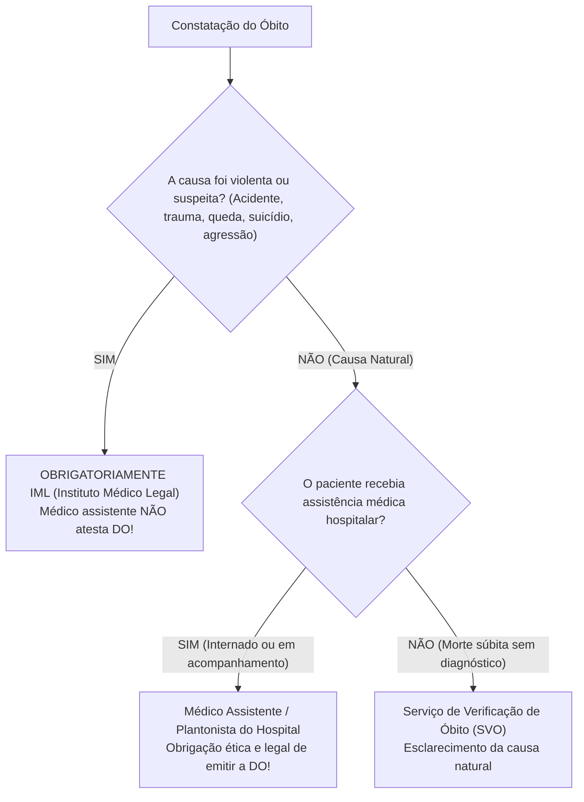

# Protocolo de Atendimento: Constatação de Óbito Hospitalar & Preenchimento da Declaração de Óbito (DO)
**Categoria:** Declaração de Óbito e Cuidados  
**Atalho Recomendado:** `;obito-do`

---

## 📋 Snippet para Prontuário Eletrônico (PEP)

```markdown
CONSTATAÇÃO DE ÓBITO HOSPITALAR & REGISTRO MÉDICO-LEGAL

IDENTIFICAÇÃO DO PACIENTE:
- Nome completo: [ ... ] | Prontuário: [ ... ] | Leito/Setor: [ ... ]
- Sexo: [ ... ] | Idade: [ ... ] anos | Data de Nascimento: [ ... ]/[ ... ]/[ ... ]
- Data e Horário Exato da Constatação do Óbito: [ ... ]/[ ... ]/[ ... ] às [ ... ]h[ ... ]min

EXAME FÍSICO CONFIRMATÓRIO DE PARADA CARDIORRESPIRATÓRIA E MORTE CLÍNICA:
Constatada ausência irreversível dos sinais vitais à beira do leito pelos seguintes critérios obrigatórios:
1. Ausência de pulso central (carotídeo e femoral) palpável constatada por mais de 1 minuto ininterrupto.
2. Ausência completa de bulhas cardíacas à ausculta precordial em todos os focos por mais de 1 minuto.
3. Ausência de movimentos respiratórios eficazes (apneia completa) à inspeção e ausculta pulmonar por mais de 1 minuto.
4. Pupilas em midríase bilateral paralítica, fixas, arreativas a estímulos luminosos intensos.
5. Ausência de reflexos de tronco encefálico (reflexo corneopalpebral e fotomotor abolidos bilateralmente).
6. Hipotonia e relaxamento muscular generalizado, ausência de resposta motora ou verbal a estímulos dolorosos centrais (pressão supraorbitária e esternal).
7. Traçado eletrocardiográfico em monitor: [ Assistolia confirmada no protocolo da linha reta / Ausência de atividade elétrica eficaz ].

CLASSIFICAÇÃO MÉDICO-LEGAL DA MORTE:
[ ] MORTE DE CAUSA NATURAL COM ASSISTÊNCIA MÉDICA HOSPITALAR:
- Paciente internado sob assistência médica, com diagnóstico clínico e etiológico conhecido e documentado em prontuário.
- Óbito decorrente de evolução natural da doença de base e suas complicações clínicas.
- Fornecida e preenchida a Declaração de Óbito (DO) pelo médico assistente/plantonista.

[ ] MORTE VIOLENTA OU COM SUSPEITA DE CAUSA EXTERNA (ENCAMINHAMENTO AO IML):
- Presença de histórico ou suspeita de: [ Acidente de trânsito / Queda com fratura prévia / Agressão física / Ferimento por arma de fogo ou branca / Intoxicação exógena aguda por veneno/drogas / Suicídio / Trauma mecânico ].
- CONDUTA MÉDICO-LEGAL OBRIGATÓRIA: NÃO emitir Declaração de Óbito no hospital. Corpo mantido sem manipulação excessiva, comunicado ao Serviço Social e acionado o Instituto Médico Legal (IML) via autoridade policial competente para realização de necropsia forense.

CADEIA CAUSAL DA DECLARAÇÃO DE ÓBITO (DO - MINISTÉRIO DA SAÚDE):
Parte I: Doença ou estado mórbido que causou diretamente a morte (Cadeia Causal Direta):
- a) Causa Imediata (evento terminal): [ ex: Choque séptico / Hemorragia digestiva maciça / Tamponamento cardíaco ]
  devido a ou como consequência de:
- b) Causa Intermediária: [ ex: Pneumonia comunitária grave / Úlcera péptica perfurada / Ruptura miocárdica ]
  devido a ou como consequência de:
- c) Causa Intermediária: [ ex: ... ]
  devido a ou como consequência de:
- d) Causa Básica (A DOENÇA DE BASE QUE INICIOU A CADEIA): [ ex: Doença Pulmonar Obstrutiva Crônica grave / Hipertensão Arterial e Aterosclerose Sistêmica / Neoplasia maligna de cólon ]

Parte II: Outras condições significativas que contribuíram para a morte, mas não entraram na cadeia causal direta:
- [ ex: Diabetes Mellitus tipo 2 / Doença Renal Crônica estágio 4 / Tabagismo ativo de longa data ].

COMUNICAÇÃO DE MÁS NOTÍCIAS & ACOLHIMENTO À FAMÍLIA:
- Notícia comunicada presencialmente em ambiente privativo, com respeito, clareza e acolhimento emocional (Protocolo SPIKES).
- Familiar presente: [ Nome completo e grau de parentesco: ... ].
- Informadas a causa básica da morte, as medidas de suporte prestadas e fornecidas as instruções burocráticas pertinentes com apoio do Serviço Social da instituição.
- Pertences pessoais do paciente conferidos e entregues ao responsável legal mediante protocolo.
```

---

## 🎯 Guia de Bolso: As Regras de Ouro Médico-Legais da Declaração de Óbito (CFM)

### 1. O que NUNCA colocar como Causa Básica (Linha D)
É terminantemente proibido e passível de devolução formal preencher a causa básica com **modos de morrer** ou sintomas vagos:
- ❌ **Parada Cardiorrespiratória (PCR):** Toda pessoa que morre para de respirar e o coração para. A PCR é a definição da morte, NUNCA a causa.
- ❌ **Falência de Múltiplos Órgãos (FMO):** É um desfecho intermediário; deve-se explicitar o que causou a falência (ex: Choque séptico secundário a peritonite por apendicite perfurada).
- ❌ **Insuficiência Respiratória Aguda / Choque:** Descrevem a fisiopatologia imediata, não a doença de base.

### 2. A Sequência Lógica Perfeita da Cadeia Causal (Parte I)
Pergunte sempre de baixo para cima: *"A doença D causou a doença C, que levou à complicação B, que resultou no evento final A."*
- **Linha a (Causa imediata):** *Choque séptico* (tempo: dias)
- **Linha b (Causa intermediária):** *Pneumonia bacteriana comunitária* (tempo: semanas)
- **Linha d (Causa básica fundamental):** *Doença Pulmonar Obstrutiva Crônica com enfisema* (tempo: anos)

### 3. Onde e Quem Atesta o Óbito?



### 4. A Queda da Própria Altura no Idoso é Causa Externa!
> [!CAUTION]
> **Armadilha Jurídica Clássica:** Idoso que cai da própria altura em casa, sofre fratura de colo de fêmur, interna, é operado, desenvolve pneumonia hospitalar ou sepse e falece 15 dias depois.
> - **Classificação Legal:** **Morte de Causa Externa / Traumática.**
> - O médico assistente do hospital **NÃO PODE emitir a Declaração de Óbito**.
> - O corpo deve ser encaminhado formalmente ao **IML**, pois o evento inicial desencadeador foi um acidente (trauma mecânico).
