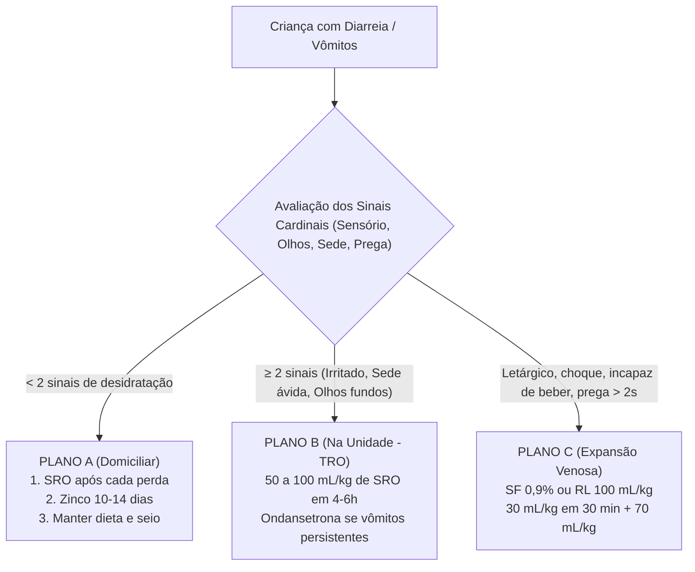

# Protocolo de Atendimento: Gastroenterite Aguda (GECA) & Planos de Desidratação da OMS
**Categoria:** Gastrointestinal e Desidratação  
**Atalho Recomendado:** `;ped-desidratacao`

---

## 📋 Snippet para Prontuário Eletrônico (PEP)

```markdown
ATENDIMENTO PEDIÁTRICO - GASTROENTERITE AGUDA (GECA) & DESIDRATAÇÃO

IDENTIFICAÇÃO:
- Paciente: [ ... ] | Idade: [ ... ] anos/meses | Sexo: [ ... ] | PESO ATUAL: [ ... ] kg
- Informante: [ Mãe / Pai / Responsável: ... ]

HISTÓRIA CLÍNICA:
- QP: Diarreia líquida e vômitos há [ ... ] dias.
- HMA: Quadro iniciado há [ ... ] dias com evacuações líquidas [ frequência: ... episódios nas últimas 24h, aspecto aquoso amarelado/esverdeado sem sangue ] e episódios de vômitos [ frequência: ... vezes/dia ].
- Febre: [ Tax aferida no domicílio: ... °C / Afebril ].
- Presença de Sangue / Muco nas Fezes: [ AUSENTE (Diarreia aquosa viral típica) / PRESENTE (Disenteria bacteriana - alerta para Shigella/Salmonella/Campylobacter) ].
- Ingesta de Líquidos e Diurese: [ Bebendo líquidos normalmente / Sede aumentada, bebendo avidamente / Recusa total de líquidos / Incapaz de beber por vômitos ]. Diurese presente nas últimas 6h com fralda úmida.

NEGATIVAS MANDATÓRIAS PEDIÁTRICAS:
- Nega letargia profunda ou coma.
- Nega sangue vivo em fezes.
- Nega dor abdominal localizada contínua com descompressão dolorosa.
- Nega anúria por mais de 8 a 12 horas.

EXAME FÍSICO & AVALIAÇÃO DO ESTADO DE HIDRATAÇÃO (OMS / MINISTÉRIO DA SAÚDE):
- Sinais Vitais: FC: [ ... ] bpm | FR: [ ... ] irpm | SpO2: [ ... ]% ar ambiente | Tax: [ ... ] °C | TEC: [ ... ] segundos.
- Tabela dos 4 Sinais Cardinais de Desidratação:
  1. Condição Geral / Sensório: [ Alerta e ativo (0) / Irritado, intranquilo (1) / Letárgico, sonolento ou comatoso (2) ].
  2. Olhos: [ Normais (0) / Fundos (1) / Muito fundos e secos (2) ].
  3. Sede e Capacidade de Beber: [ Bebe normalmente, sem sede especial (0) / Sedento, bebe rápido e avidamente (1) / Bebe mal ou não é capaz de beber (2) ].
  4. Sinal da Prega Cutânea no Abdome: [ Pele volta ao normal imediatamente (0) / Desaparece lentamente em < 2s (1) / Desaparece muito lentamente em > 2s (2) ].
  * Outros sinais: Lágrimas [ presentes / ausentes ]; Saliva e mucosa oral [ úmida / seca / ressecada em fita ]; Fontanela [ plana / deprimida ].

CLASSIFICAÇÃO DO ESTADO DE HIDRATAÇÃO (OMS):
[ ] PLANO A: SEM DESIDRATAÇÃO CLÍNICA (< 2 sinais de desidratação).
[ ] PLANO B: DESIDRATAÇÃO MODERADA (Presença de 2 ou mais sinais, incluindo sede ávida ou irritabilidade).
[ ] PLANO C: DESIDRATAÇÃO GRAVE / CHOQUE HIPOVOLÊMICO (Letargia/inconsciência, olhos muito fundos, incapacidade de beber e sinal da prega > 2 segundos).

---

CONDUTA TERAPÊUTICA POR PLANO CLÍNICO:

[ ] CONDUTA PLANO A (TRATAMENTO DOMICILIAR):
As 4 Regras de Ouro:
1. Soro de Reidratação Oral (SRO - 75 mEq/L) após cada perda líquida:
   - Se < 2 anos: Oferecer **50 a 100 mL de SRO** após cada evacuação líquida ou vômito.
   - Se ≥ 2 anos: Oferecer **100 a 200 mL de SRO** após cada evacuação líquida ou vômito.
2. Manter a alimentação habitual e aleitamento materno (NÃO diluir fórmula, NÃO jejuar).
3. Suplementação de Zinco (Sulfato de Zinco):
   - Se < 6 meses: **10 mg/dia VO** durante 10 a 14 dias.
   - Se ≥ 6 meses: **20 mg/dia VO** durante 10 a 14 dias (Reduz duração e recorrência em até 3 meses).
4. Sinais de perigo orientados detalhadamente.

[ ] CONDUTA PLANO B (TERAPIA DE REIDRATAÇÃO ORAL - TRO NA UNIDADE):
- Administrar **SRO na unidade de saúde**: volume de **50 a 100 mL/kg** durante 4 a 6 horas.
- Administrar em pequenos volumes frequentes com colher ou copinho (5 a 10 mL a cada 2 a 3 minutos).
- Se vômitos persistentes que impeçam a TRO: **Ondansetrona 0,15 mg/kg VO/EV dose única** (aguardar 15-30 min e reiniciar SRO lentamente).
- Reavaliar o estado de hidratação a cada 1 a 2 horas:
  * Se hidratou: Alta para o Plano A com SRO e Zinco.
  * Se piorou: Transicionar para o Plano C.

[ ] CONDUTA PLANO C (EXPANSÃO VENOSA IMEDIATA NA GRAVIDADE / CHOQUE):
- Acesso venoso periférico calibroso imediato (ou intraósseo se falha > 90 segundos).
- Infusão de Soro Fisiológico 0,9% ou Ringer Lactato conforme protocolo do Ministério da Saúde:
  * Se < 1 ano de idade:
    - Fase rápida: 30 mL/kg em 30 minutos.
    - Fase lenta: 70 mL/kg em 5 horas e 30 minutos (Total: 100 mL/kg em 6 horas).
  * Se ≥ 1 ano de idade:
    - Fase rápida: 30 mL/kg em 30 minutos.
    - Fase lenta: 70 mL/kg em 2 horas e 30 minutos (Total: 100 mL/kg em 3 horas).
- Iniciar SRO por via oral (5 mL/kg/h) logo que a criança recupere a consciência e consiga beber.

---

PRESCRIÇÃO AMBULATORIAL (PLANO A):
1. Sais de Reidratação Oral (SRO em envelopes): Diluir 1 envelope em exatamente 1 litro de água filtrada/fervida.
   - Oferecer [ 50 a 100 mL / 100 a 200 mL ] aos poucos após cada evacuação líquida ou episódio de vômito.
2. Sulfato de Zinco (solução oral ou gotas):
   - Administrar [ 10 mg / 20 mg ] por via oral 1x ao dia durante 14 dias consecutivos.
3. Dipirona gotas 500 mg/mL (se febre ou cólica): Dar [ 1 gota/kg = ... gotas ] VO até de 6/6h.

PROSCRIÇÕES FORMAIS NA DIARREIA INFANTIL:
- PROIBIDOS: Loperamida (Imosec) e outros inibidores da motilidade intestinal. Risco de íleo paralítico, perfuração intestinal e morte.
- PROIBIDOS: Antiespasmódicos com escopolamina em lactentes.
- PROIBIDOS: Antibióticos em diarreia aquosa sem sangue (quadro viral na quase totalidade).

SINAIS DE ALARME PARA RETORNO IMEDIATO:
- Piora da diarreia ou vômitos contínuos sem tolerar líquidos.
- Sangue visível nas fezes.
- Olhos fundos, choro sem lágrimas ou boca muito seca.
- Ausência de urina por mais de 6 horas (fraldas secas).
- Sonolência excessiva, fraqueza extrema ou dificuldade para acordar.
```

---

## 🎯 Guia de Bolso: Manejo da Desidratação Pediátrica em 3 Passos



> [!TIP]
> **Por que o Zinco é Obrigatório pelo Ministério da Saúde e OMS?**
> A suplementação de zinco (10 mg/dia se < 6 meses; 20 mg/dia se ≥ 6 meses por 10 a 14 dias) acelera a regeneração das microvilosidades do epitélio intestinal, reduz a duração do episódio de diarreia em 25% e protege contra novos episódios de diarreia nos 2 a 3 meses subsequentes.
