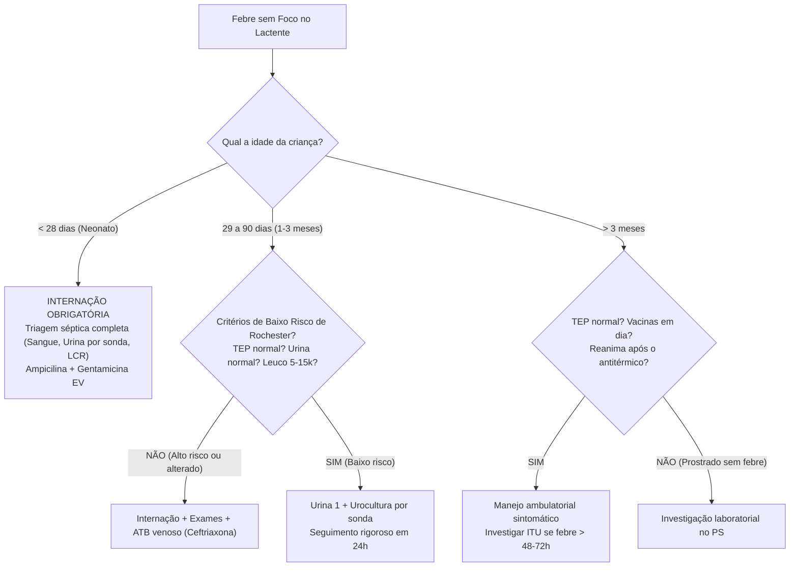

# Protocolo de Atendimento: Febre sem Foco & Manejo do Lactente Febril
**Categoria:** Febre e Infecções Sistêmicas  
**Atalho Recomendado:** `;ped-febre`

---

## 📋 Snippet para Prontuário Eletrônico (PEP)

```text
ATENDIMENTO PEDIÁTRICO - FEBRE SEM FOCO NO LACTENTE

IDENTIFICAÇÃO & FAIXA ETÁRIA CRÍTICA:
- Lactente: [ ] | Idade: [ ] dias / meses | PESO ATUAL: [ ] kg
- FAIXA ETÁRIA CLÍNICA:
  [ ] REPARTO NEONATAL: Recém-nascido (< 28 dias de vida) - ALERTA MÁXIMO DE SEPSE NEONATAL.
  [ ] LACTENTE JOVEM: 29 a 90 dias de vida (1 a 3 meses).
  [ ] LACTENTE MAIOR: 3 a 36 meses.
- Informante: [Mãe / Pai / Responsável: ]

HISTÓRIA DA FEBRE:
- Início do quadro há [ ] dias/horas.
- Temperatura máxima axilar aferida com termômetro: [ ] °C.
- Frequência dos picos febris e resposta a antitérmicos: [ Febre cede com antitérmico e a criança reanima / Febre de difícil controle ].
- Sintomas associados ativamente interrogados:
  * Sintomas respiratórios (tosse, coriza, espirros): [ Ausentes ].
  * Sintomas gastrointestinais (vômitos, diarreia): [ Ausentes ].
  * Sintomas urinários (choro ao urinar, urina com odor forte, redução de fraldas): [ Ausentes / Mãe relata urina fétida ].
- Comportamento no intervalo sem febre: [ Criança sorri, brinca, mama bem e interage / Permanece prostrada, sonolenta e sem interagir mesmo afebril ].
- Histórico Vacinal: [ Vacinação antipneumocócica e meningocócica em dia / Atrasada ].

NEGATIVAS MANDATÓRIAS PEDIÁTRICAS (SINAIS DE SEPSE & MENINGOCOCEMIA):
- Nega manchas vermelhas ou arroxeadas na pele (petéquias, sufusões hemorrágicas ou púrpuras).
- Nega gemência contínua, tiragem torácica ou batimento de asa de nariz.
- Nega crises convulsivas ou abalos motores focais.
- Nega recusa alimentar total ou vômitos incoercíveis.
- Nega abaulamento da fontanela anterior.

EXAME FÍSICO OBJETIVO:
- Sinais Vitais: FC: [ ] bpm | FR: [ ] irpm | SpO2: [ ]% ar ambiente | Tax no momento: [ ] °C | TEC: [ ] segundos (< 2s).
- Triângulo de Avaliação Pediátrica (TEP): Aparência [ normal / alterada ], Trabalho respiratório [ normal / aumentado ], Circulação cutânea [ normal / alterada ].
- Ectoscopia Minuciosa: Estado geral [ BEG / REG / MEG ], corado, hidratado, anictérico, acianótico.
  * Inspeção de Pele Completa (criança despida): [Pele limpa, sem lesões elementares, sem petéquias ou exantemas purpúricos / Lesões presentes: ].
  * Fontanela Anterior: [ Plana, normotensa, pulsátil fisiológica / Abaulada e tensa / Deprimida ].
- Oroscopia & Otoscopia: Faringe e amígdalas sem alterações, membranas timpânicas translúcidas sem abaulamento.
- Ausculta Pulmonar & Cardíaca: Murmúrio vesicular presente bilateralmente sem estertores; bulhas normofonéticas sem sopros.
- Abdome: Flácido, indolor, sem visceromegalias.
- Sistema Nervoso & Sinais Meníngeos: Tônus normal, movimentação espontânea e simétrica dos 4 membros, reflexo de sucção preservado, ausência de rigidez de nuca (Brudzinski e Kernig negativos).

AVALIAÇÃO & CONDUTA POR FAIXA ETÁRIA:

[ ] 1. RECÉM-NASCIDO (< 28 DIAS DE VIDA):
- Risco de Infecção Bacteriana Grave (IBG) de até 10-15% (*Strepto agalactiae*, *E. coli*, *Listeria*).
- CONDUTA OBRIGATÓRIA: INTERNAÇÃO HOSPITALAR IMEDIATA.
  * Colheita de Triagem Séptica Completa: Hemograma, PCR, Hemoculturas (2 sítios), Urina 1 + Urocultura (por cateterismo vesical), Punção Lombar diagnóstica para LCR (celularidade, proteínas, glicose, bacterioscopia e cultura).
  * Início de antibioticoterapia venosa empírica: Ampicilina (150-200 mg/kg/dia) + Gentamicina (4-5 mg/kg/dia) ou Cefotaxima.

[ ] 2. LACTENTE DE 29 A 90 DIAS (1 A 3 MESES):
- Aplicação dos Critérios de Baixo Risco de Rochester:
  * Critérios Clínicos: Lactente a termo, hígido, TEP normal, sem foco infeccioso ao exame físico.
  * Propedêutica Mínima Mandatória na Emergência:
    - **Urina tipo 1 + Urocultura (por sondagem de alívio):** A Infecção do Trato Urinário é o foco bacteriano oculto mais prevalente.
    - Hemograma completo + Proteína C Reativa (PCR).
  * Se Baixo Risco ( Rochester negativo, exames normais): Observação clínica ambulatorial com retorno médico garantido em 24 horas.
  * Se Alto Risco ou Toxemia: Internação hospitalar + Ceftriaxona 50-100 mg/kg/dia EV + Punção lombar se indicado.

[ ] 3. LACTENTE DE 3 A 36 MESES (COM VACINAÇÃO EM DIA):
- Criança com TEP estável, ativa após antitérmico e com vacinas pneumo/meningo em dia (risco de bacteremia oculta < 0,5%):
  * Investigar Infecção do Trato Urinário (ITU): Solicitar Urina 1 + Urocultura se febre > 48h sem foco (em meninas < 2 anos ou meninos < 1 ano não circuncidados).
  * Manejo ambulatorial sintomático com reavaliação médica programada.

---

PRESCRIÇÃO AMBULATORIAL (SE CRITÉRIOS DE BAIXO RISCO):
1. Dipirona gotas 500 mg/mL: Dar [ 1 gota/kg = ... gotas ] VO até de 6/6h se Tax ≥ 37,8°C.
2. Hidratação oral vigorosa (livre demanda de seio materno ou água).
3. Reavaliação médica ambulatorial obrigatória em 24 a 48 horas (ou coleta de Urina 1 se febre persistente).

SINAIS DE ALARME DE SEPSE (RETORNO IMEDIATO):
- Surgimento de pontinhos vermelhos ou manchas roxas na pele que não somem ao pressionar com um copo de vidro.
- Criança que não acorda, não interage, não sorri ou geme continuamente mesmo após baixar a febre.
- Respiração muito rápida com afundamento do peito.
- Vômitos contínuos ou recusa total de qualquer líquido.
- Crise convulsiva ou extremidades frias e arroxeadas.
```

---

## 🎯 Guia de Bolso: Algoritmo de Decisão na Febre sem Foco


